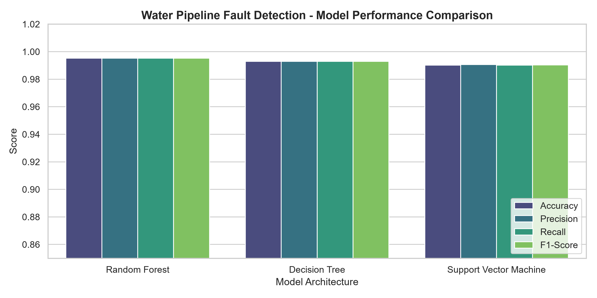
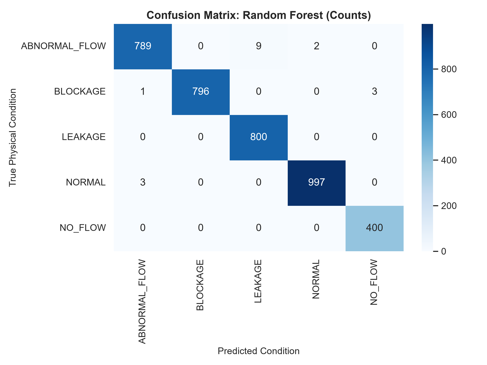
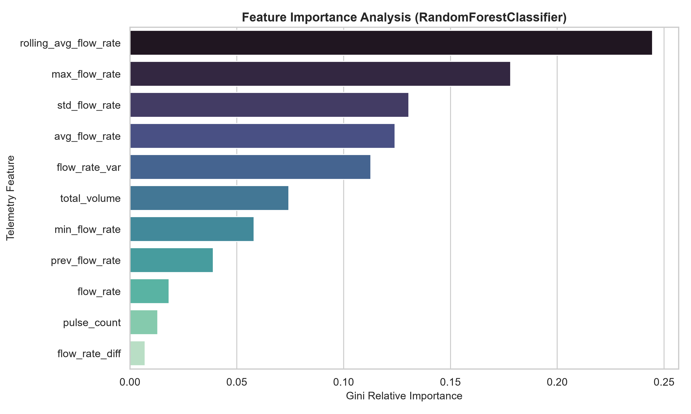

<div align="center">

# 💧 AI-Based Water Pipeline Fault Detection System
### Real-Time IoT Edge Telemetry & Machine Learning Condition Monitoring

[](https://www.python.org/)
[](https://streamlit.io/)
[](https://www.espressif.com/)
[](https://scikit-learn.org/)
[](LICENSE)

An industrial-grade IoT and AI pipeline monitoring solution combining an **ESP32 microcontroller**, a **YF-S201 Hall-effect water flow sensor**, an **advanced rolling-feature ML inference engine**, and an interactive **Streamlit telemetry dashboard**.

[Key Features](#-key-features) • [System Architecture](#-system-architecture) • [Hardware & Wiring](#-hardware-setup--electrical-wiring) • [Machine Learning](#-machine-learning-benchmark-results) • [Quickstart](#-quickstart-guide) • [Physical Fault Testing](#-physical-fault-simulation-guide)

</div>

---

## 🌟 Key Features

- **⚡ Edge Computing with ESP32**: High-speed hardware interrupts (`IRAM_ATTR`) measure pulse frequencies and compute instantaneous flow rate ($L/\text{min}$) and cumulative volume ($L$) with atomic thread-safety.
- **🛡️ Electrical Level Protection**: Safe resistive voltage-divider ($1\text{ k}\Omega / 2\text{ k}\Omega$) steps down $5\text{V}$ sensor pulses to $3.33\text{V}$ logic to protect ESP32 GPIOs.
- **📈 11-Dimensional Telemetry Vectors**: Real-time sliding window extraction computing mean, min, max, standard deviation, variance, pulse counts, cumulative volumes, first-difference deltas, and rolling baselines.
- **🤖 High-Accuracy Machine Learning**: Benchmarked across Random Forest, Decision Tree, and Support Vector Machines using **GroupShuffleSplit** to eliminate adjacent time-series data leakage (**99.53% test accuracy**).
- **🎛️ Hysteresis Debounce Filter**: Multi-sample consecutive confirmation ($N=3$) prevents transient turbulence or valve chattering from triggering false alarms.
- **📊 Real-Time Streamlit Dashboard**: Live KPI cards, dynamic flow & volume charts, AI class probability spectrum, color-coded status badges, and persistent CSV audit logging.
- **🧪 Hardware + Simulator Dual Mode**: Plug in your physical ESP32 via USB (`COM4`) or run the built-in test-rig simulator to test and demonstrate all 5 fault scenarios on-demand.

---

## 🏗️ System Architecture

```
[ Water Pipeline ]
        │
        ▼ (Fluid flow rotates internal turbine)
[ YF-S201 Sensor ] (Hall-effect pulse train: 5V DC)
        │
        ▼ (1kΩ / 2kΩ Resistive Voltage Divider: 5V -> 3.3V Logic Protection)
[ ESP32 MCU (GPIO 27) ]
        │ (Hardware interrupt counts pulses; computes Flow Rate & Total Volume)
        │ (Formatted as structured JSON payload)
        ▼ (USB Serial / UART @ 115200 Baud)
[ Host Laptop / PC ]
        ├── PySerial Stream Engine (Robust line buffering & error recovery)
        ├── Rolling Window Telemetry Buffer (11 dynamic statistical features)
        ├── Machine Learning Inference Engine (Random Forest Champion: 99.53% F1)
        ├── Debounce / Hysteresis Filter (3-sample consecutive state confirmation)
        └── Streamlit Industrial Dashboard (Live KPIs, Charts, Alert Badges, CSV Audit Log)
```

---

## 🔌 Hardware Setup & Electrical Wiring

### Required Components:
1. **ESP32 Development Board** (NodeMCU / DOIT ESP32 DevKit V1)
2. **YF-S201 Water Flow Sensor** ($1/2''$ male pipe threads, $1-30\text{ L/min}$ range)
3. **Resistors**: $1\text{ k}\Omega$ and $2\text{ k}\Omega$ (or $10\text{ k}\Omega$ and $20\text{ k}\Omega$)
4. **USB Cable** (data-capable connecting ESP32 to laptop)
5. **Plumbing Rig** (tubing, tap source or submersible pump, and ball valves)

### ⚠️ Critical Electrical Safety Notice
> **Warning**: The YF-S201 Hall sensor operates on $5\text{V}$ and outputs $5\text{V}$ logic pulses. ESP32 GPIO pins are strictly rated for $3.3\text{V}$ maximum! Connecting the sensor signal directly will damage the ESP32. Always use a voltage divider:

```
  YF-S201 Output (Yellow Wire, 5V Pulse)
                 │
                ┌┴┐
                │ │  R1 = 1.0 kΩ (or 10 kΩ)
                └┬┘
                 ├───► Connect to ESP32 GPIO 27 (Peak input: ~3.33V Safe Logic)
                ┌┴┐
                │ │  R2 = 2.0 kΩ (or 20 kΩ)
                └┬┘
                 │
           Common Ground (GND)
```

### Wiring Table:
| YF-S201 Wire | Function | Target Connection |
| :--- | :--- | :--- |
| **RED** | VCC ($+5\text{V}$) | ESP32 **VIN** / **5V** Pin (supplied via USB) |
| **BLACK** | GND ($0\text{V}$) | ESP32 **GND** Pin |
| **YELLOW** | Digital Pulse SIG | **$R_1$ ($1\text{ k}\Omega$)** input $\rightarrow$ Center tap to **GPIO 27** $\rightarrow$ **$R_2$ ($2\text{ k}\Omega$)** to GND |

---

## 🤖 Machine Learning Benchmark Results

The synthetic dataset consists of **15,000 time-series samples** across **150 independent experiment runs** (30 runs per condition, 100 seconds per run) generated using stochastic autoregressive Ornstein-Uhlenbeck processes. Data leakage was strictly avoided using `GroupShuffleSplit` on `run_id` (75% train, 25% test).

### Benchmark Summary Table:
| Model Architecture | Test Accuracy | Precision (Weighted) | Recall (Weighted) | F1-Score | Data Scaling |
| :--- | :---: | :---: | :---: | :---: | :---: |
| **🌲 Random Forest (Champion)** | **99.53%** | **99.53%** | **99.53%** | **0.9953** | Raw |
| **🌳 Decision Tree** | 99.29% | 99.29% | 99.29% | 0.9929 | Raw |
| **📈 Support Vector Machine (SVM)** | 99.03% | 99.06% | 99.03% | 0.9903 | StandardScaler |

<div align="center">

### Model Comparison


### Confusion Matrix (Champion Random Forest)


### Feature Importance (Gini Ranking)


</div>

---

## 🚦 Pipeline Condition States & Color Codes

| State | Visual Indicator | Flow Characteristics | What the AI Identifies |
| :--- | :---: | :--- | :--- |
| **NORMAL** | 🟢 **GREEN** | $2.8 - 4.5\text{ L/min}$, $\sigma \approx 0.12$ | Stable nominal flow with normal turbulence. |
| **LEAKAGE** | 🔴 **RED** | $4.8 - 7.5\text{ L/min}$, $\sigma \approx 0.35$ | Unexpected elevated continuous discharge (*Suspected Leakage*). |
| **BLOCKAGE** | 🟠 **ORANGE** | $0.0 - 1.4\text{ L/min}$, fluttering | Choked fluid delivery, throttled pulse frequency. |
| **NO FLOW** | ⚪ **GREY** | $0.0\text{ L/min}$, 0 pulses | Pipe stagnant, pump off or line isolated. |
| **ABNORMAL FLOW** | 🟡 **YELLOW** | $0.5 - 9.0\text{ L/min}$, $\sigma > 0.8$ | Rapid surge oscillations, water hammer, cavitation, air bubbles. |

> **Single-Sensor Engineering Note**: A single flow sensor measures flow at one cross-section. Elevated flow cannot be definitively distinguished from authorized downstream draw without differential flow metering ($\Delta Q = Q_{\text{in}} - Q_{\text{out}}$). Therefore, elevated flows are conservatively flagged as **`SUSPECTED LEAKAGE`**.

---

## 🚀 Quickstart Guide

### 1. Clone the Repository
```bash
git clone https://github.com/SiddharthTamminedi/tdp1.git
cd tdp1
```

### 2. Install Dependencies
```bash
pip install -r water_pipeline_ai/requirements.txt
```

### 3. Flash ESP32 Firmware
1. Open [esp32_flow_sensor.ino](water_pipeline_ai/esp32/esp32_flow_sensor.ino) in the Arduino IDE.
2. Select your board (**ESP32 Dev Module**) and active port (e.g., `COM4`).
3. Click **Upload**.

### 4. Launch the Streamlit Telemetry Dashboard
```bash
streamlit run water_pipeline_ai/dashboard/app.py
```
*The dashboard will automatically open in your default browser at `http://localhost:8501`.*

### 5. Start Real-Time Monitoring
- Select **Live ESP32 (Hardware Serial)** and choose your port (`COM4`), or select **Test Rig Simulator (Demo Mode)**.
- Click **▶ START**.

---

## 🧪 Physical Fault Simulation Guide

| Condition | Valve / Rig Action | Expected Dashboard Response |
| :--- | :--- | :--- |
| **NORMAL** | Set water tap or mini-pump to steady, medium flow rate (~$3.5\text{ L/min}$). | Badge turns 🟢 **NORMAL (HEALTHY)**. |
| **LEAKAGE** | Open a secondary downstream bypass valve or maximize tap opening ($> 5.5\text{ L/min}$). | Badge turns 🔴 **SUSPECTED LEAKAGE**. |
| **BLOCKAGE** | Partially pinch the tube or close an inline valve to throttle flow below $1.2\text{ L/min}$. | Badge turns 🟠 **PIPELINE BLOCKAGE**. |
| **NO FLOW** | Close the main supply valve completely ($0\text{ L/min}$). | Badge turns ⚪ **NO FLOW (STAGNANT)**. |
| **ABNORMAL FLOW** | Rapidly open and close the tap, or shake the intake hose to introduce air bubbles. | Badge turns 🟡 **ABNORMAL FLOW DYNAMICS**. |

---

## 📂 Repository Layout

```
tdp1/
│
├── water_pipeline_ai/                 # Core AI & IoT application package
│   ├── dataset/
│   │   └── water_pipeline_dataset.csv # 15,000 time-series sensor samples
│   ├── models/
│   │   ├── water_pipeline_model.pkl   # Serialized champion Random Forest bundle
│   │   ├── scaler.pkl                 # StandardScaler preprocessor
│   │   ├── classification_report.txt  # Detailed test metrics
│   │   ├── confusion_matrix.png       # Confusion matrix plot
│   │   ├── feature_importance.png     # Feature importance plot
│   │   └── model_comparison.png      # Comparison across ML algorithms
│   ├── esp32/
│   │   └── esp32_flow_sensor.ino      # ESP32 firmware (atomic ISR + JSON stream)
│   ├── training/
│   │   ├── generate_dataset.py        # Time-series dataset generation script
│   │   └── train_model.py             # Multi-model benchmarking script
│   ├── dashboard/
│   │   └── app.py                     # Streamlit real-time monitoring dashboard
│   ├── logs/
│   │   └── pipeline_logs.csv          # Telemetry and fault audit logger
│   └── requirements.txt               # Dependencies
│
├── .gitignore                         # Python, Streamlit, and IDE ignore rules
├── LICENSE                            # MIT Open Source License
└── README.md                          # GitHub repository documentation
```

---

## 📄 License

This project is licensed under the MIT License - see the [LICENSE](LICENSE) file for details.

---

<div align="center">
Developed with ❤️ by Siddharth Tamminedi
</div>
